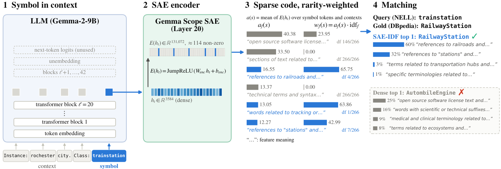
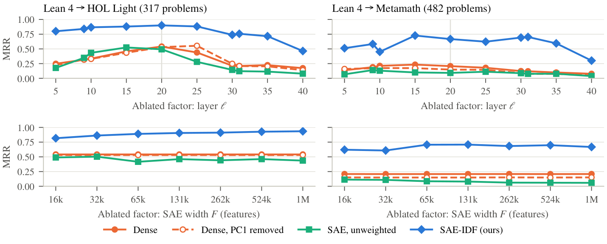

# Sparse Autoencoders Are a Shared Coordinate System for Symbolic Matching

[](https://arxiv.org/abs/2610.19636)
[](https://arxiv.org/pdf/2610.19636)
[](#citation)

This repository holds the code, result snapshots and LaTeX source for **SAE-IDF**, a training-free
method that matches symbols across heterogeneous symbolic systems: formal-mathematics provers,
programming languages, table schemas, knowledge graphs, and multilingual and biomedical ontologies.
Each symbol is read by an LLM in its own system's context and encoded by a pretrained sparse
autoencoder (SAE). Each feature is weighted by its rarity, and candidates are ranked by cosine.
Because every coordinate is a named SAE feature, each match decomposes into the concepts that
produce it.



*Figure 1. SAE-IDF on the NELL class `trainstation` (Common-KG NELL → DBpedia).*
1. *A native view (context first, symbol last) goes through the LLM, and the residual stream is read at the symbol's tokens.*
2. *The SAE encoder maps each state to a sparse code, and the codes are averaged.*
3. *idf damps features that fire on many symbols (grey).*
4. *Each bar is a feature's share of the cosine with the query. 93% of the match with the gold `RailwayStation` comes from two features for railroads and stations. The dense hidden state ranks the gold fifth.*

## Why

Much symbolic knowledge already exists, but it is spread across many domain-specific systems, each
with its own schema. A data-driven route to a larger symbolic system is to align and merge existing
ones, and its first step is to match units across those systems. An LLM reads almost any notation,
but its dense hidden states are anisotropic. A few dominant directions swamp the similarity between
two symbols, and a dense coordinate cannot be read to explain a match. An SAE's dictionary rewrites
the same hidden state as a sparse sum of interpretable features. That gives a coordinate system
shared by every system the model can read, in which classic inverse document frequency applies.

## Method in four steps

1. **Native context.** Each symbol is read in context taken from its own system: the formal
   statement, the program, the column name with sampled cell values, a class's instances, or a
   term's axioms. No text is generated.
2. **Sparse code.** The residual stream at the symbol's tokens (Gemma-2-9B layer 20, or
   Llama-3.1-8B layer 15) is encoded by a pretrained SAE (Gemma Scope / Llama Scope, 131k features).
   The codes are averaged over tokens and views into $a(s)$.
3. **Rarity weighting.** $w(s) = a(s) \odot \mathrm{idf}$, with
   $\mathrm{idf}_f = \big[\log \tfrac{N}{1+\mathrm{df}(f)}\big]_+$ computed over a reference collection of $N$
   symbols. A feature that fires on every symbol gets weight zero.
4. **Matching.** Candidates are ranked by $\cos(w(s), w(t))$. The cosine decomposes exactly over
   shared features, $\sum_f w_f(s)\,w_f(t) / (\lVert w(s)\rVert\,\lVert w(t)\rVert)$, and each feature
   has a Neuronpedia explanation.

Nothing is trained or fine-tuned, and no part of the method is specific to one kind of system.

## Results

**Main results** (12 tasks across 6 kinds of symbolic system, native context, 131k-feature SAEs).
SAE-IDF beats the same model's dense hidden state on all 14 rows with Gemma-2-9B and on 13 of 14
with Llama-3.1-8B. The largest gain is +0.45 MRR, on Lean 4 → Metamath.

**Gemma-2-9B** (layer 20, Gemma Scope 131k)

| Task | Metric | Strings | Dense | Dense −PC1 | **SAE-IDF (ours)** | Δ dense |
|:--|:--|--:|--:|--:|--:|--:|
| *Formal mathematics (miniF2F)* | | | | | | |
| Lean 4 → Isabelle | MRR | 0.825 | 0.912 | 0.926 | **0.961** | +0.05 |
| Lean 4 → Metamath | MRR | 0.615 | 0.210 | 0.151 | **0.661** | +0.45 |
| Lean 4 → HOL Light | MRR | 0.741 | 0.539 | 0.531 | **0.898** | +0.36 |
| *Code (XLCoST, program level)* | | | | | | |
| 7 languages, mean | MRR† | **0.468** | 0.454 | 0.452 | 0.464 | +0.01 |
| 7 languages, mean | P@6† | **0.745** | 0.680 | 0.678 | 0.732 | +0.05 |
| *Table schemas (Valentine)* | | | | | | |
| source → target columns | F1 | – | 0.533 | 0.534 | **0.614** | +0.08 |
| source → target columns | MRR | – | 0.766 | 0.761 | **0.856** | +0.09 |
| *Knowledge graphs (OAEI Common-KG)* | | | | | | |
| NELL → DBpedia | MRR | 0.936 | 0.931 | 0.957 | **0.976** | +0.04 |
| YAGO → Wikidata | MRR | 0.899 | 0.860 | 0.932 | **0.962** | +0.10 |
| *Cross-lingual ontologies (MultiFarm)* | | | | | | |
| Chinese → English | MRR | 0.230 | 0.650 | **0.760** | 0.754 | +0.10 |
| Russian → English | MRR | 0.234 | 0.644 | 0.751 | **0.765** | +0.12 |
| Arabic → English | MRR | 0.238 | 0.595 | 0.702 | **0.722** | +0.13 |
| *Biomedical ontologies (Bio-ML, Anatomy)* | | | | | | |
| NCIT → DOID | MRR | 0.779 | 0.701 | 0.732 | **0.817** | +0.12 |
| mouse → human | MRR | 0.734 | 0.812 | 0.864 | **0.886** | +0.07 |

**Llama-3.1-8B** (layer 15, Llama Scope 131k)

| Task | Metric | Strings | Dense | Dense −PC1 | **SAE-IDF (ours)** | Δ dense |
|:--|:--|--:|--:|--:|--:|--:|
| *Formal mathematics (miniF2F)* | | | | | | |
| Lean 4 → Isabelle | MRR | 0.825 | 0.942 | 0.944 | **0.976** | +0.03 |
| Lean 4 → Metamath | MRR | 0.615 | 0.646 | 0.637 | **0.787** | +0.14 |
| Lean 4 → HOL Light | MRR | 0.741 | 0.603 | 0.699 | **0.906** | +0.30 |
| *Code (XLCoST, program level)* | | | | | | |
| 7 languages, mean | MRR† | **0.468** | 0.451 | 0.447 | 0.442 | −0.01 |
| 7 languages, mean | P@6† | **0.745** | 0.641 | 0.648 | 0.657 | +0.02 |
| *Table schemas (Valentine)* | | | | | | |
| source → target columns | F1 | – | 0.588 | 0.579 | **0.625** | +0.04 |
| source → target columns | MRR | – | 0.786 | 0.811 | **0.862** | +0.08 |
| *Knowledge graphs (OAEI Common-KG)* | | | | | | |
| NELL → DBpedia | MRR | 0.936 | 0.949 | **0.960** | 0.958 | +0.01 |
| YAGO → Wikidata | MRR | 0.899 | 0.889 | **0.944** | **0.944** | +0.06 |
| *Cross-lingual ontologies (MultiFarm)* | | | | | | |
| Chinese → English | MRR | 0.230 | 0.659 | 0.779 | **0.787** | +0.13 |
| Russian → English | MRR | 0.234 | 0.661 | **0.751** | 0.726 | +0.06 |
| Arabic → English | MRR | 0.238 | 0.578 | 0.669 | **0.672** | +0.09 |
| *Biomedical ontologies (Bio-ML, Anatomy)* | | | | | | |
| NCIT → DOID | MRR | 0.779 | 0.704 | 0.710 | **0.779** | +0.08 |
| mouse → human | MRR | 0.734 | 0.800 | **0.871** | 0.844 | +0.04 |

How to read the tables:
- **Bold** marks the best value per row, Strings included; ties go to the model's columns.
- *Δ dense* is SAE-IDF minus the dense hidden state of the same model.
- *Strings* is the best of word TF-IDF, character 3–5-gram TF-IDF and BM25 over the same views,
  chosen per task in their favour. For XLCoST it is word TF-IDF, and Valentine has no comparable
  string baseline.
- *Dense −PC1* is the mean-centred dense vector with its first principal direction removed.
- † XLCoST's official metrics, averaged over the seven query languages.

Trained retrievers (BGE-M3, Qwen3-Embedding-8B), whitening and other dense controls, a held-out
idf library and paired-bootstrap significance tests are in the paper's appendix.

**Both ingredients are needed.** A random dictionary of the same width and sparsity with the same
idf weighting falls far short, and so do the learned SAE features without the weighting.

| Task | Metric | Random + idf | SAE unweighted | **SAE-IDF (ours)** |
|:--|:--|--:|--:|--:|
| *Formal mathematics (miniF2F)* | | | | |
| Lean 4 → Isabelle | MRR | 0.865 | 0.882 | **0.961** |
| Lean 4 → Metamath | MRR | 0.146 | 0.095 | **0.661** |
| Lean 4 → HOL Light | MRR | 0.349 | 0.493 | **0.898** |
| *Code (XLCoST, program level)* | | | | |
| 7 languages, mean | MRR† | 0.417 | 0.449 | **0.464** |
| 7 languages, mean | P@6† | 0.627 | 0.673 | **0.732** |
| *Table schemas (Valentine)* | | | | |
| source → target columns | F1 | 0.482 | 0.458 | **0.614** |
| source → target columns | MRR | 0.647 | 0.685 | **0.856** |
| *Knowledge graphs (OAEI Common-KG)* | | | | |
| NELL → DBpedia | MRR | 0.901 | 0.938 | **0.976** |
| YAGO → Wikidata | MRR | 0.797 | 0.872 | **0.962** |
| *Cross-lingual ontologies (MultiFarm)* | | | | |
| Chinese → English | MRR | 0.533 | 0.404 | **0.754** |
| Russian → English | MRR | 0.542 | 0.252 | **0.765** |
| Arabic → English | MRR | 0.425 | 0.225 | **0.722** |
| *Biomedical ontologies (Bio-ML, Anatomy)* | | | | |
| NCIT → DOID | MRR | 0.692 | 0.696 | **0.817** |
| mouse → human | MRR | 0.788 | 0.801 | **0.886** |

**Robust across configurations.** SAE-IDF beats dense, Dense −PC1 and the unweighted code in every
one of 39 configurations on miniF2F. The configurations vary layer, SAE width, sparsity, model size
(Gemma-2-2B to 27B) and model family.



*Figure 2. Layer (top; 131k-feature SAE at each layer) and SAE width at matched sparsity (bottom;
layer 20) with Gemma-2-9B on miniF2F Lean 4 → HOL Light and → Metamath.*

## Repository layout

| Directory | Contents |
|---|---|
| `formal/` | miniF2F cross-prover retrieval files (`prepare_minif2f.py`), every ordered prover pair (`make_prover_pairs.py`), held-out prover libraries for the idf (`make_library.py`) |
| `xlcost/` | Dense / SAE / SAE-IDF representations (`run_xlcost_sae.py`) and official XLCoST scoring (`eval_xlcost_sae.py`); used for any XLCoST-format file (XLCoST, miniF2F, PubChem) |
| `schema/` | Valentine column representations and Valentine's own metrics |
| `kg/`, `multilingual/`, `ontology/` | OAEI Common-KG, MultiFarm and Anatomy preparation (`ontology/prepare_icd.py`: a task dropped for lack of context) |
| `native/` | Native views for classes and terms, built from each benchmark's own files |
| `bioml/` | Hidden-state cache, SAE encoding and idf analysis shared by the ontology and KG tasks; Bio-ML; LLM-generated contexts (appendix comparison); Neuronpedia feature explanations |
| `chem/`, `medical/` | PubChem SMILES / IUPAC / InChI (appendix task) and drug names (dropped) |
| `tools/` | String and retriever baselines, dense controls, random dictionary, abstention, merge and transitivity, match decomposition and explanation labels, failure sample |
| `jobs/delta/` | SLURM scripts for the GPU runs |
| `paper/` | LaTeX source, table and figure generators, and `paper/data/`, the result snapshots behind every table and figure |
| `kg_sae_pipeline/` | Early prototype on the OAEI Knowledge Graph track; not used in the paper |

## Reproducing the tables and figures (no GPU)

`paper/data/` holds the numbers behind every table and figure:

```bash
cd paper
python make_tables.py                      # rewrites tables/*.tex; every number is copied by code
python significance.py                     # paired bootstrap over queries
cd figures && for f in fig_*.py; do python "$f"; done
```

The `collect_*.py` scripts rebuild `paper/data/` from the raw run outputs, which are not in the
repository.

## Running the pipeline

**Requirements.** Python 3.10, PyTorch, transformers, safetensors, numpy, scipy, scikit-learn,
pandas, rdflib, requests and matplotlib. Valentine scoring also needs `valentine`. The scripts that
call an LLM API (generated contexts and explanation labels) also need `anthropic` or `openai`. They
read the API key from a key file or an environment variable, never from the command line.

**Models and SAEs** (Hugging Face): `google/gemma-2-9b` (and the 2B / 27B sizes),
`google/gemma-scope-9b-pt-res`, `meta-llama/Llama-3.1-8B`, `OpenMOSS-Team/Llama-Scope`, plus
`BAAI/bge-m3` and `Qwen/Qwen3-Embedding-8B` for the retriever baselines.

**Benchmarks**, from their official releases and under their own licenses: miniF2F,
miniF2F-lean4, XLCoST, Valentine, OAEI Common-KG / MultiFarm / Anatomy, Bio-ML and PubChem.

Each script documents its inputs, outputs and an example call in its docstring. Defaults point to
our cluster's paths, so pass `--model_path`, `--sae_path` and the data arguments explicitly. One
Gemma-2-9B run with the 131k SAE fits on a single 48 GB GPU.

<details>
<summary><b>Formal mathematics (miniF2F)</b></summary>

`formal/prepare_minif2f.py` keeps only each problem's statement. It strips everything that
identifies a problem without reading the mathematics (names, proofs, comments, Metamath labels),
and refuses to write a dataset if a problem id survives. The output is in XLCoST format, so the
XLCoST runner and evaluator are reused unchanged.

```bash
python formal/prepare_minif2f.py --minif2f <openai/miniF2F> \
    --minif2f_lean4 <yangky11/miniF2F-lean4> --output_dir <minif2f_xsys>
python xlcost/run_xlcost_sae.py --dataset_file <minif2f_xsys>/Metamath/all.jsonl \
    --model_path <gemma-2-9b> --sae_path <gemma-scope>/layer_20/width_131k/average_l0_114/params.npz \
    --output_dir <out>/lean4_Metamath
python xlcost/eval_xlcost_sae.py --run_dir <out>/lean4_Metamath --output_dir <out>/lean4_Metamath/eval
python tools/lexical_baseline.py --dataset_file <minif2f_xsys>/Metamath/all.jsonl
```
</details>

<details>
<summary><b>Code (XLCoST)</b></summary>

Get the dataset from the [XLCoST repository](https://github.com/reddy-lab-code-research/XLCoST) and
keep its layout. Every token is SAE-encoded before pooling, never after, because the JumpReLU
threshold applies per token. Scoring follows the official protocol: the pool contains the query's
own row, so the first hit is free, and `--exclude_self` reports the variant without it. Predictions
are written in the official format, and `--official_evaluator` cross-checks them with XLCoST's own
script.

```bash
python xlcost/run_xlcost_sae.py --data_dir <code2codesearch>/dataset/program_level \
    --lang Java --split test --model_path <gemma-2-9b> \
    --sae_path <gemma-scope>/layer_20/width_131k/average_l0_114/params.npz \
    --output_dir <out>/xlcost_java_program
python xlcost/eval_xlcost_sae.py --run_dir <out>/xlcost_java_program \
    --official_evaluator <XLCoST>/code/codesearch/code2codesearch/evaluator/evaluator.py
```
</details>

<details>
<summary><b>Table schemas (Valentine)</b></summary>

The main-table layout writes each column as its name followed by 16 sampled cell values, as one
view. Scores come from Valentine's own implementation: F1 with one-to-one assignment, and MRR.

```bash
python schema/run_valentine_sae.py --data_root <Valentine-datasets> --output_dir <out>/valentine \
    --model_path <gemma-2-9b> --sae_path <sae> --preset column --max_length 1024
python schema/eval_valentine_sae.py --run_dir <out>/valentine --output_dir <out>/valentine/eval
```
</details>

<details>
<summary><b>Knowledge graphs and ontologies (Common-KG, MultiFarm, Bio-ML, Anatomy)</b></summary>

`native/build_native_views.py {commonkg,multifarm,bioml,anatomy}` builds one view per piece of
system-internal context, context first and symbol last:

    Instance: Edward Thomas (poet). Class: Writer        # Common-KG: the class's instances
    domain 作者. Term: 撰写论文                            # MultiFarm: the term's own axioms
    Parent: Intestinal Atresia. Class: Duodenal Atresia   # Bio-ML / Anatomy: definitions, parents

Synonyms are never used, since across systems a synonym is often the other side's label. The views
are then cached, encoded and scored:

```bash
python native/build_native_views.py commonkg --data_dir <commonkg> --output_dir <views>
python bioml/cache_bioml_hidden.py --context_run_dirs <views>/nell_dbpedia --output_dir <hidden> \
    --layers 20 --contexts 0 --label_last
python bioml/encode_bioml_cached.py --cache_dir <hidden> --layer 20 --sae_path <sae> --output_dir <run>
python bioml/analyze_bioml_idf.py --sae_run_dirs <run> --context_run_dirs <views>/nell_dbpedia \
    --background all --fast --lexical --output_dir <run>/analysis
```

`--contexts 0` keeps every view and `--label_last` pools the symbol's final occurrence. The cache
stores several layers at once, so `encode_bioml_cached.py` re-encodes the same run with any layer
or SAE (Gemma Scope `params.npz` or Llama Scope `final.safetensors`) without the model.
</details>

<details>
<summary><b>Baselines, controls and analyses</b></summary>

| Script | What it does |
|---|---|
| `tools/lexical_baseline.py` | Word / character n-gram TF-IDF and BM25 over the same views (`--xlcost_official` for XLCoST's metrics) |
| `tools/embed_baseline.py` | BGE-M3 or Qwen3-Embedding-8B on the same views, with the same centring and PC1 controls |
| `tools/dense_controls.py` | Whitening, z-scoring, top-k PC removal and an idf over dense coordinates |
| `tools/random_dictionary.py` | A random SAE of the same width and sparsity, loadable through `--sae_path` |
| `tools/interpret_matches.py` | Decomposes each match into named features with their Neuronpedia explanations and Pile densities |
| `tools/abstention_curves.py` | Precision against coverage when the matcher abstains on low-margin queries |
| `tools/global_merge_transitivity.py` | Whether pairwise matches compose into one consistent merge (XLCoST, four provers) |
| `bioml/autointerp_bioml_neuronpedia.py` | Neuronpedia explanations for the features behind each match (Gemma Scope layer 20, 131k) |
</details>

## Citation

If you use this code, please cite the paper ([arXiv:2610.19636](https://arxiv.org/abs/2610.19636)):

```bibtex
@misc{yang2026sparse,
  title         = {Sparse Autoencoders Are a Shared Coordinate System for Symbolic Matching},
  author        = {Yang, Xiaocong and Meng, Xuanyu and Zhang, Yuji and Han, Jiawei and Zhai, ChengXiang},
  year          = {2026},
  eprint        = {2610.19636},
  archivePrefix = {arXiv},
  primaryClass  = {cs.LG},
  url           = {https://arxiv.org/abs/2610.19636}
}
```
